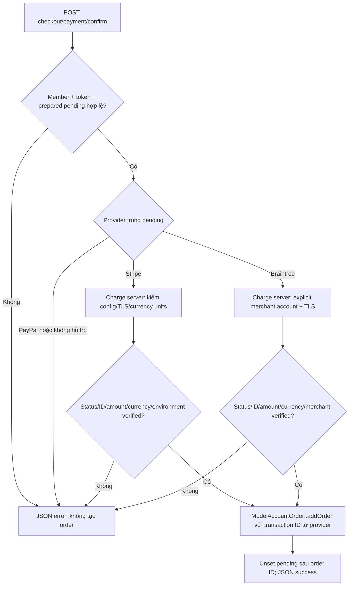

# Hiện hành sau P0-B — xác nhận paid order

Lớp/model/SQL hiện hữu được giữ. Luồng controller/gateway thay đổi so với diagram baseline tại commit `7fcbe3b27bb7ac04e10895f9d5a64fa964659fbe`:

Legacy `marketplace/braintree/payment` chỉ redirect về checkout; `marketplace/paypal/send` trả error, không invoice/order. `checkout/payment/paypal` render unavailable và không chạy browser SDK, chờ server capture integration. Result pages của P0-A tiếp tục không ghi order. Lỗi AJAX hoặc JSON rỗng không báo success.

`ControllerCheckoutPayment::paymentGateway()` protected tạo gateway mặc định và là seam test; không có public service mới. Shared HTTP payment adapters bật TLS verification; CloudStorage chưa đổi. Currency snapshot thêm trong pending session, không thêm cột DB.

Đây chưa phải kiến trúc durable payment intent/outbox. Session concurrency, CSRF overwrite tại startup, atomicity, provider sandbox và settlement recovery vẫn cần xử lý. Xem [biên bản P0-B](../improvements/P0-B-payment-confirmation.md). Các diagram/export gốc là lịch sử trước sửa, không đại diện cho nhánh success/fallback hiện tại.

Review bổ sung trong cùng P0-B: các cạnh `verified` hiện yêu cầu proof đúng cấu trúc/kiểu (Stripe integer amounts, transaction ID dạng chuỗi, currency dạng chuỗi, Braintree decimal Amount). Payload sai định dạng trả error trước model order; không thêm layer hoặc đổi schema. Chi tiết red→green và điều kiện sandbox tại biên bản P0-B.
