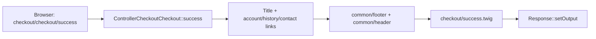

# Cập nhật hiện hành — nhóm P0-A / PAY-02

**Cập nhật tiếp theo:** P0-B đã thay đổi confirm và các legacy completion; xem [luồng hiện hành](current-payment-confirmation.md). Các nhận xét “chưa sửa PAY-01” bên dưới phản ánh thời điểm kết thúc P0-A.

Áp dụng lên working tree sau audit baseline `7fcbe3b27bb7ac04e10895f9d5a64fa964659fbe`. Các inventory/diagram/export trước đó là chứng cứ **trước sửa**, không phải trạng thái payment result hiện tại. Không chạy lại inventory baseline để hợp thức hóa source mới.

Trong `application/controller/checkout/checkout.php::success()`, nhánh `pending_extension_order → ModelAccountOrder::addOrder()` đã bị loại bỏ. Không có layer/service mới; đây là thay đổi luồng thực thi. Result page không load order model, không gọi addOrder và không unset pending. Render và links giữ nguyên. Failure/terms và legacy marketplace success không đổi.

Không có cạnh từ result page tới `addOrder()`. `checkout/payment::confirm()` và các completion legacy vẫn tồn tại, chưa được sửa/verified trong P0-A; pending không phải proof thanh toán. Các node mô tả success tạo đơn trong `04-frontend-flow.drawio` và mục PAY-02 của tài liệu audit phải được đọc như baseline. Xem [biên bản P0-A](../improvements/P0-A-result-pages.md) để biết test và rủi ro còn tồn tại.
